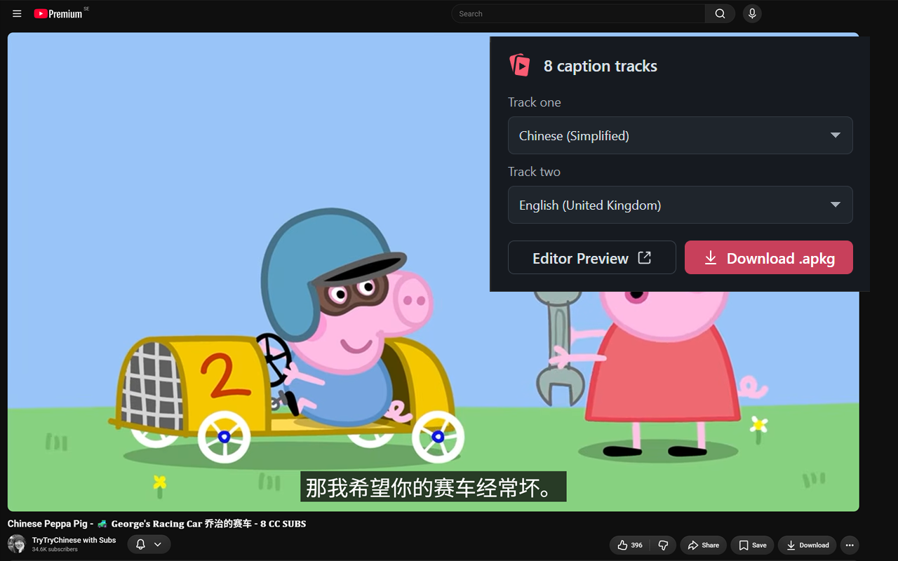
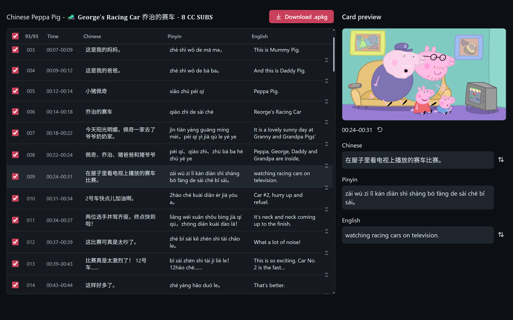
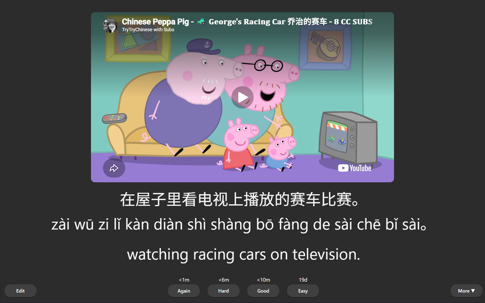

## yt2anki

Chromium extension that turns YouTube videos into Anki cards.

[Chrome Web Store Link](https://chromewebstore.google.com/detail/yt2anki/gjnnnafjhfnjckdpjkfnapipfceihgcg)

#### Popover

#### Edit, merge, and preview

#### Imported Anki card

[Privacy](PRIVACY.md) · [License](LICENSE) · [Dependency notices](THIRD_PARTY_NOTICES.md)
